<div align="center">

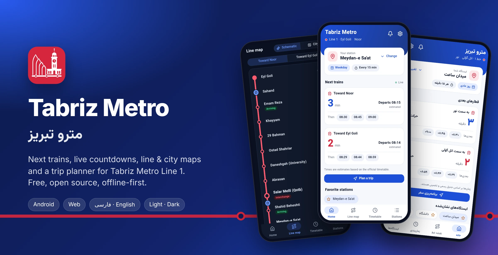

<br>

# Tabriz Metro

**The friendly, open-source companion for riders of Tabriz Metro Line 1.**
<br>
Next trains, live countdowns, line &amp; city maps, a trip planner and smart reminders, all offline-first.

<br>

[](https://github.com/TssHack/tabriz-metro/actions/workflows/ci.yml)
[](https://github.com/TssHack/tabriz-metro/releases/latest)
[](https://github.com/TssHack/tabriz-metro/releases)
[](https://flutter.dev)
[](LICENSE)
[](https://github.com/TssHack/tabriz-metro/stargazers)

[**Download APK**](https://github.com/TssHack/tabriz-metro/releases/latest) ·
[**Features**](#-features) ·
[**Screenshots**](#-screenshots) ·
[**Build**](#-getting-started) ·
[**Contribute**](#-contributing)

</div>

---

## ✨ Why Tabriz Metro?

Tabriz Metro Line 1 runs 18 stations from **Eyl Goli** to **Noor**, but its timetable lives on printed posters. This app turns those official timetables into something you can actually use on the go: open it, see how many minutes until your train, and get moving.

- 🚇 **Built for riders.** One glance tells you the next train in both directions.
- 📴 **Offline-first.** The whole timetable ships inside the app, so it works with no connection.
- 🔒 **Private by design.** Your location never leaves your device. There are no accounts, no tracking and no servers.
- 🌍 **Bilingual.** Persian (RTL, Persian digits) and English, in light and dark themes.

## 🚀 Features

| | Feature | What it does |
|:-:|---|---|
| ⏱️ | **Next trains** | Live minute countdown for both directions from your station, plus the next few departures |
| 📅 | **Smart schedule** | Picks the weekday or Friday/holiday timetable automatically, with a manual override |
| 🗺️ | **Schematic line map** | All 18 stations with estimated train positions, the interchange and "arriving" badges |
| 📍 | **City map** | OpenStreetMap view with your nearest station, walking distance and time, and the train you can still catch |
| 🕒 | **Full timetable** | Every departure for any station, grouped by hour, with past trains dimmed and auto-scroll to now |
| 🔎 | **Station search** | Persian/Arabic-aware search (ی/ي, ک/ك, ZWNJ), favorites and a "near me" filter |
| 🧭 | **Trip planner** | Walk, wait and ride time, arrival time and stop count between any two stations |
| 🔔 | **Automations** | Leave-now reminder, destination alert one stop early, auto nearest station, last-train reminder, daily commute shortcut. All are local notifications |
| ⚙️ | **Rich settings** | Theme, text size, digits, language, walking speed, default station, schedule mode and update channel |
| ⬆️ | **In-app updater** | Checks GitHub Releases (stable or beta), supports Wi-Fi-only and skip-version, and verifies every APK with SHA-256 before installing |

> [!NOTE]
> All times are **estimates** derived from the official published timetable. Real-world service can differ.

## 📸 Screenshots

<div align="center">

<table>
  <tr>
    <td align="center">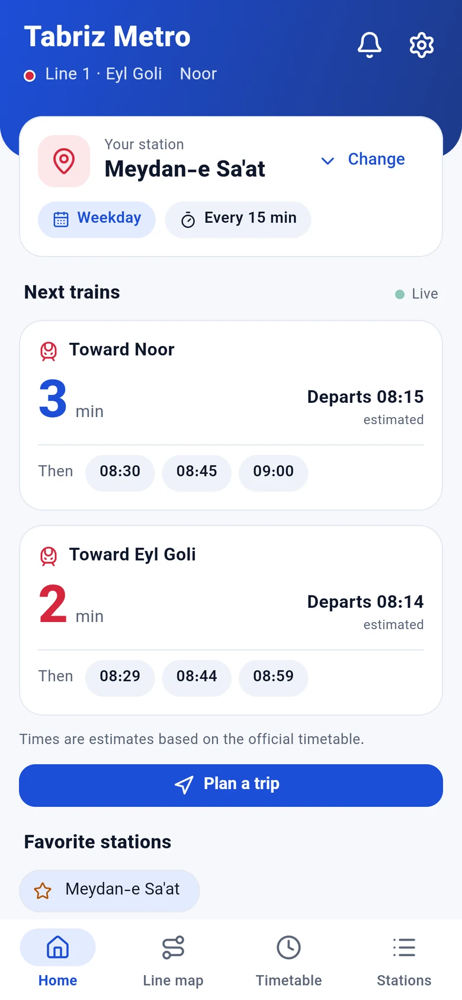<br><sub><b>Home</b></sub></td>
    <td align="center">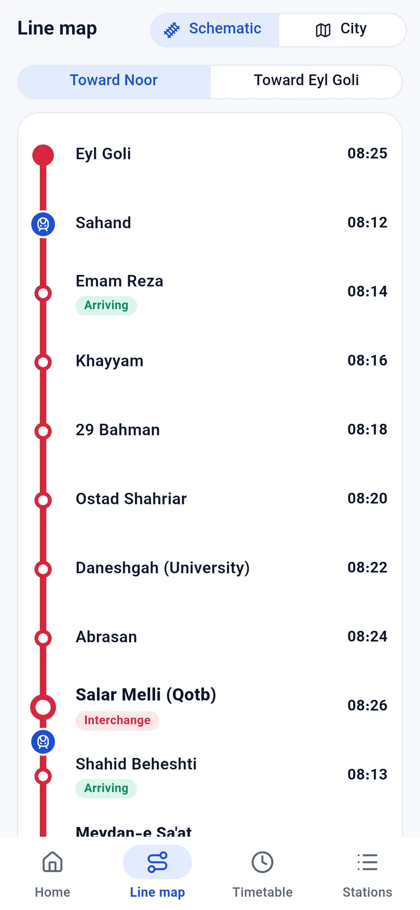<br><sub><b>Line map</b></sub></td>
    <td align="center">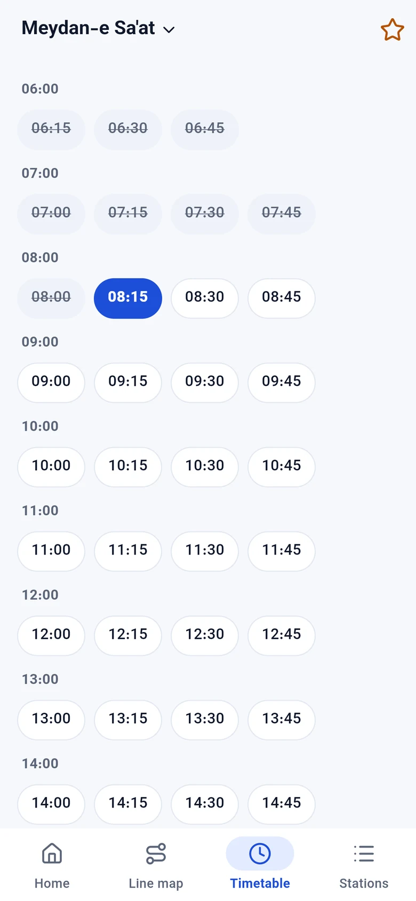<br><sub><b>Timetable</b></sub></td>
    <td align="center">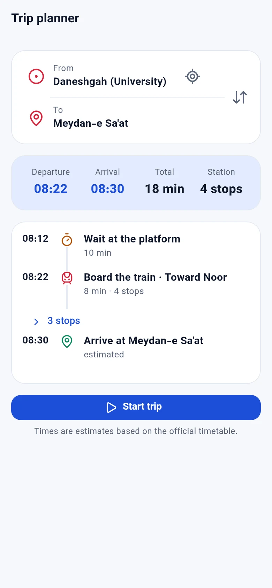<br><sub><b>Trip planner</b></sub></td>
  </tr>
  <tr>
    <td align="center">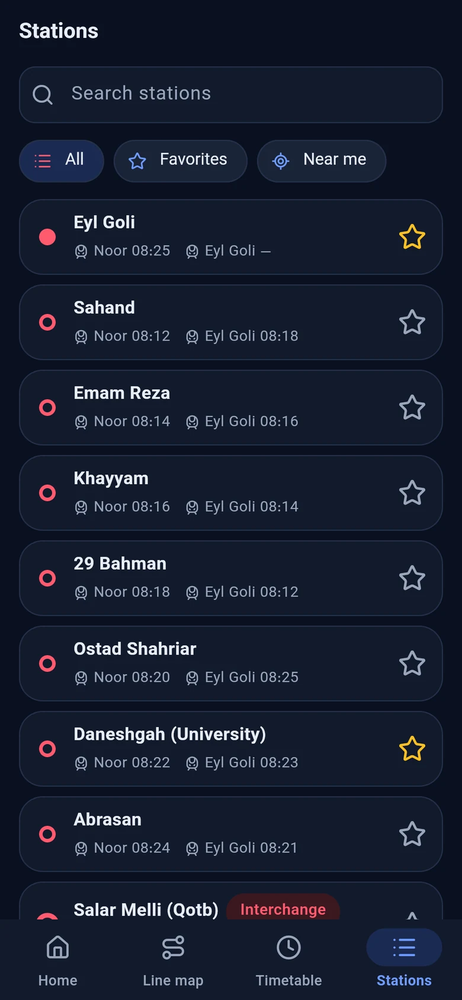<br><sub><b>Stations · dark</b></sub></td>
    <td align="center">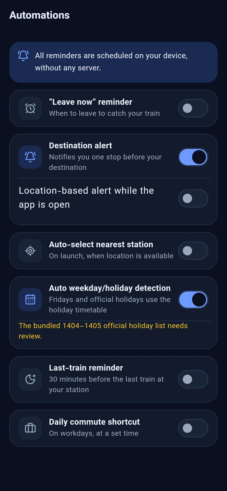<br><sub><b>Automations · dark</b></sub></td>
    <td align="center">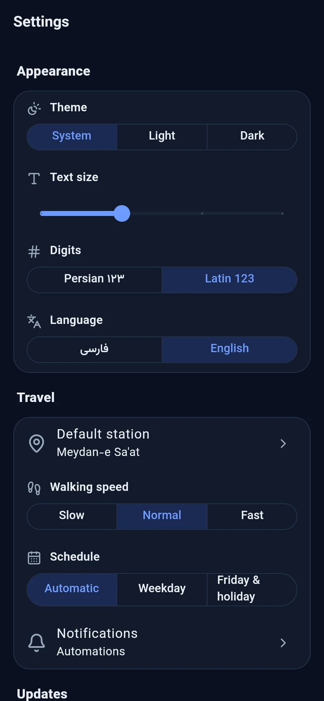<br><sub><b>Settings · dark</b></sub></td>
    <td align="center">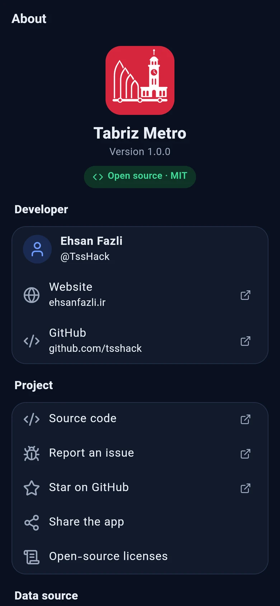<br><sub><b>About · dark</b></sub></td>
  </tr>
</table>

<details>
<summary><b>Persian UI (RTL)</b></summary>
<br>
<table>
  <tr>
    <td align="center"></td>
    <td align="center">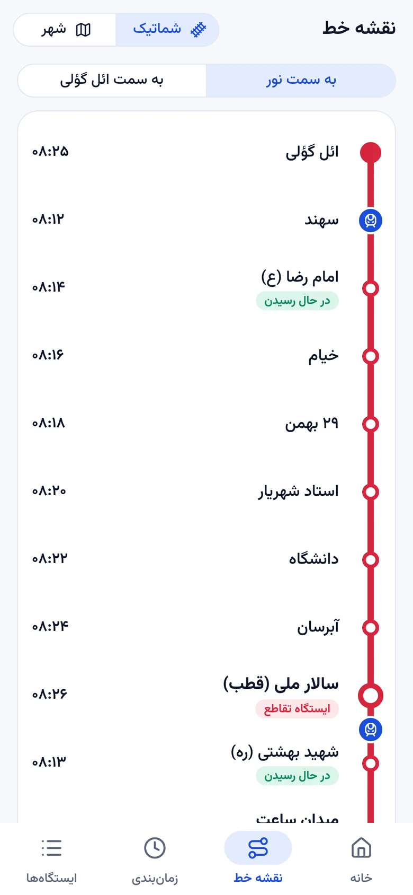</td>
    <td align="center">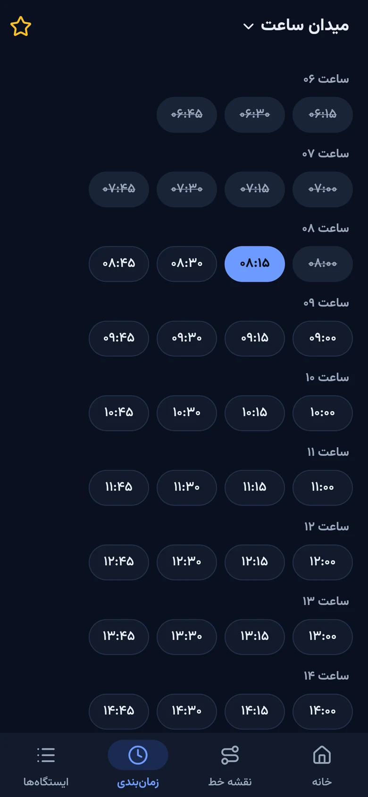</td>
    <td align="center">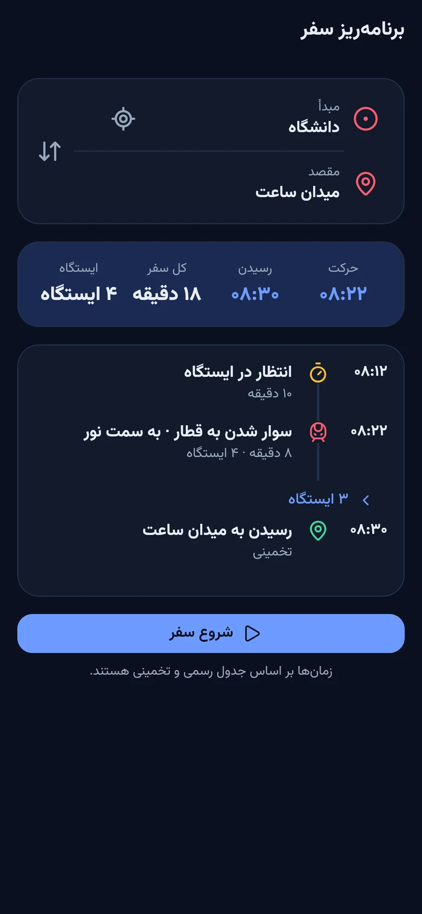</td>
  </tr>
</table>
</details>

</div>

## 📥 Download

Grab the latest build from **[GitHub Releases](https://github.com/TssHack/tabriz-metro/releases/latest)**.

| File | Best for |
|---|---|
| `tabriz-metro-vX.Y.Z-arm64-v8a-release.apk` | Most modern Android phones (recommended) |
| `tabriz-metro-vX.Y.Z-armeabi-v7a-release.apk` | Older 32-bit Android phones |
| `tabriz-metro-vX.Y.Z-x86_64-release.apk` | Emulators and x86 devices |
| `tabriz-metro-vX.Y.Z-release.apk` | Universal build for any device (larger) |
| `tabriz-metro-vX.Y.Z-web.zip` | Static web build you can self-host |

Every file comes with a `.sha256` checksum, and `checksums.txt` lists them all:

```bash
sha256sum -c tabriz-metro-v1.0.0-arm64-v8a-release.apk.sha256
```

Once installed, the app keeps itself up to date through the built-in updater.

## 🛠️ Getting started

**Requirements:** [Flutter](https://docs.flutter.dev/get-started/install) stable (Dart 3), and the Android SDK for Android builds.

```bash
git clone https://github.com/TssHack/tabriz-metro.git
cd tabriz-metro

flutter pub get      # also generates localizations
flutter analyze
flutter test
flutter run          # pick a device, or add -d chrome for the web
```

### Build

```bash
flutter build apk --release --split-per-abi   # Android, one APK per ABI
flutter build apk --release                   # Android, universal APK
flutter build web --release                   # Web, output in build/web
```

## 🧱 Tech stack

| Area | Choice |
|---|---|
| UI | Flutter · Material 3 · custom design tokens (`ThemeExtension`) · Vazirmatn font |
| State | Riverpod 3 |
| Navigation | go_router |
| Maps | flutter_map + OpenStreetMap tiles · latlong2 |
| Location | geolocator (on-device only) |
| Notifications | flutter_local_notifications + timezone |
| Updates | GitHub Releases API · http · crypto (SHA-256) · open_filex |
| i18n | `gen-l10n` with ARB files (Persian is the template) |

## 🗂️ Project structure

```text
lib/
├── app/        App widget, router, providers and persisted settings
├── core/       Design tokens, theme, Persian digits & search, shared widgets
├── data/       Models, JSON parsing, repositories (assets, GitHub Releases)
├── domain/     Pure Dart, no Flutter imports:
│   ├── schedule/   Schedule engine and holiday detection
│   ├── geo/        Distances and nearest station
│   ├── trip/       Trip planner
│   ├── automation/ Reminder scheduling
│   └── update/     SemVer and release selection
├── features/   One folder per screen (home, line_map, timetable, stations,
│               trip, location, automations, settings, update, about)
└── l10n/       ARB translation files
data/           Timetable, station coordinates and holiday list
test/           Unit tests (core, data, domain) and widget tests
```

The `domain` layer is plain Dart, so the schedule logic is fast to test and easy to reuse.

## 🔄 Releases & updates

Pushing a tag `vX.Y.Z` (or `vX.Y.Z-beta.N` for the beta channel) runs [`release.yml`](.github/workflows/release.yml). The workflow:

1. builds split-per-ABI and universal APKs and a web bundle,
2. writes a `<file>.sha256` per file plus `checksums.txt`,
3. publishes everything as a GitHub Release.

The in-app updater only offers releases from the user's channel, and **refuses to install an APK whose checksum does not match**.

<details>
<summary><b>Release signing</b></summary>

For properly signed releases, add these repository secrets:

| Secret | Value |
|---|---|
| `ANDROID_KEYSTORE_BASE64` | Your `.jks` keystore, base64-encoded |
| `ANDROID_KEYSTORE_PASSWORD` | Keystore password |
| `ANDROID_KEY_ALIAS` | Key alias |
| `ANDROID_KEY_PASSWORD` | Key password |

Locally you can use `android/key.properties` (`storeFile`, `storePassword`, `keyAlias`, `keyPassword`), which is git-ignored.
**Without these, release APKs are signed with the debug key.** That is fine for testing, but users cannot upgrade to a differently signed build later without reinstalling.

</details>

## 📊 Data sources

| Data | Source |
|---|---|
| Timetable (weekday every 15 min, Friday/holiday every 16 min) | Official posters of the Tabriz Urban Railway Organization (Mehr 1404). See [`data/README.md`](data/README.md) |
| Station coordinates & line shape | [OpenStreetMap](https://www.openstreetmap.org/relation/6168103), © OpenStreetMap contributors, ODbL |
| Official holidays 1404–1405 | [`data/iran-holidays.json`](data/iran-holidays.json) |

> [!WARNING]
> **Help us verify the data.** Station coordinates come from OSM and have not been officially verified. OSM lists *Salar-e Melli* as "Meydan-e Qotb", so it was matched by route order. Lunar holiday dates are computed and may be off by one day. If you spot a mistake, please [open an issue](https://github.com/TssHack/tabriz-metro/issues/new).

## 🤝 Contributing

Contributions of every size are welcome, whether code, translations, data fixes or design feedback.

1. Fork the repo and create a branch: `git checkout -b feat/my-idea`
2. Make your change and keep `flutter analyze` and `flutter test` green
3. Use [Conventional Commits](https://www.conventionalcommits.org/) (`feat:`, `fix:`, `docs:` …)
4. Open a pull request

Please read [CONTRIBUTING.md](CONTRIBUTING.md) and our [Code of Conduct](CODE_OF_CONDUCT.md) first.

## 📄 License

Released under the [MIT License](LICENSE).
The Vazirmatn font is licensed under the [SIL Open Font License 1.1](assets/fonts/vazirmatn/OFL.txt).
Map data © [OpenStreetMap](https://www.openstreetmap.org/copyright) contributors.

## 👤 Author

<table>
  <tr>
    <td>
      <b>Ehsan Fazli</b><br>
      🌐 <a href="https://ehsanfazli.ir">ehsanfazli.ir</a><br>
      🐙 <a href="https://github.com/TssHack">@TssHack</a>
    </td>
  </tr>
</table>

<div align="center">
<br>

If this app makes your commute a little easier, please consider giving it a ⭐

<sub>Made with ❤️ in Tabriz</sub>

</div>
